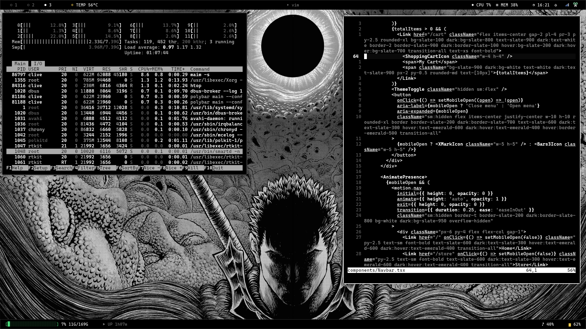
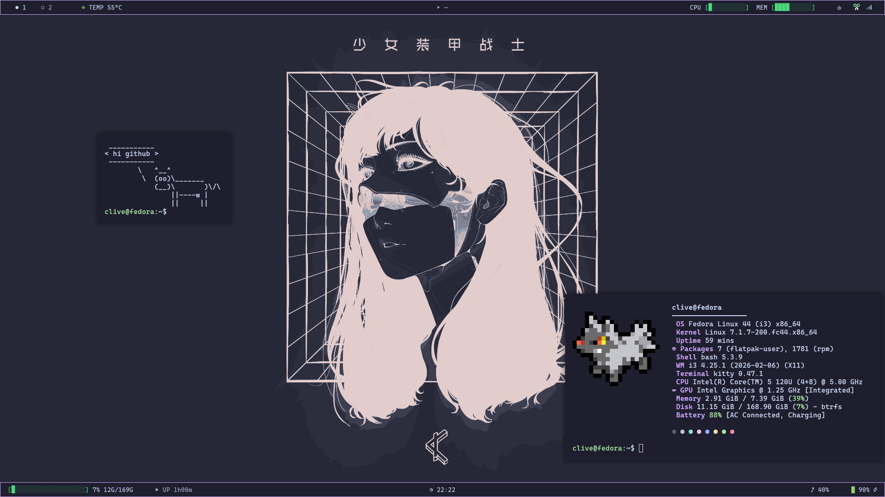

# dotfiles

My full i3 rice: window manager, bars, terminal, browser, editor, notifications,
launcher, compositor, lock screen, login screen, GTK/Qt app theming, and
wallpapers — three swappable themes (bw / invert / catppuccin) that toggle
together across all of it. Tiling moves/resizes glide.




## Install (Fedora)

```
./install.sh
```

This installs every package the rice needs via `dnf`, then symlinks each
folder here into place under `~/.config`, backing up anything already
there first.

On another distro: install the equivalent packages yourself (see
`install.sh` for the full list) and symlink the folders the same way.

After installing, log out and back into i3, or run
`~/.config/rice/toggle-theme.sh` twice to force every app to reload.

## What's in here

| Folder | What it is |
| --- | --- |
| `i3/` | Window manager config + per-theme border/title colors |
| `polybar/` | Flat full-width top bars. Primary monitor (`main`): workspaces (filled dot marks the current one), temp, volume; clock in the centre; failed-systemd-units and mic-muted warnings, CPU sparkline (`cpu.sh`), memory gauge, network (click for the rofi network panel: IP/gateway/ping/loss/throughput, DNS switcher, copy IP), bluetooth, theme button (left-click picker, right-click new wallpaper), tray. Other monitors (`side`): that monitor's workspaces and the clock. `launch.sh` starts one bar per monitor. Icons are tinted per theme via `colors-*.ini` (`c1`..`c4`) |
| `kitty/` | Terminal config + per-theme colors: rounded powerline tabs, beam cursor with a theme-colored trail, a bit of line spacing, curly link underlines, thin split borders with inactive panes dimmed (cosmetic only — kitty's default keys) |
| `dunst/` | Notification daemon config, per theme — rounded separated cards below the top bar, themed progress bars for the volume/brightness OSD |
| `rofi/` | Launcher, calculator, emoji picker, clipboard picker, bluetooth picker, and the network panel (`network-info.sh`: live IP/gateway/DNS/ping/loss/throughput for the wired connection, one-click DNS switching between DHCP/Cloudflare/Google or any IP you type, copy IP) — opened from polybar's network icon. `layout.rasi` is the shared look (search pill header, icons, mode tabs on `$mod+d`); each `theme-*.rasi` is just a palette that imports it |
| `qutebrowser/` | Browser config (theme-aware, reads `rice/theme`) |
| `picom/` | Compositor: `picom.conf`, shared by every theme: xrender, fades, soft shadows, rounded corners, pop-in/out and gliding tiling moves |
| `gammastep/` | Fixed dawn/dusk color temperature window (no longer auto-started; see `gammastep-prompt` below) |
| `flameshot/` | Screenshot tool config |
| `fastfetch/` | Theme-matched, animated system-info banner on new terminals — always shows a random Pokemon (via `pokemon-colorscripts`, auto-cloned by `install.sh`) instead of a plain logo |
| `rice/` | The glue: `toggle-theme.sh` (cycles bw → invert → catppuccin across everything, or jumps to one given as an argument), `theme-picker.sh` (rofi menu of themes with palette swatches), `keybinds.sh` (searchable cheatsheet of every i3 binding, parsed live from `i3/config`), `set-wallpaper.sh`, lock screen (blurred, theme-toned, with a lock glyph and the date), icon-row power menu (`polybar/powermenu.sh`, `$mod+Shift+p`), on-screen volume/brightness display, workspace layout save/restore, scratchpad terminal, focus-border pulse, `gammastep-prompt.sh` (dusk notification asking whether to turn on warm colors, fired by the `gammastep-prompt` systemd --user timer below), Obsidian theme CSS |
| `systemd/user/` | `gammastep-prompt.timer` fires at 19:00 daily, running `gammastep-prompt.service` → `rice/gammastep-prompt.sh` |
| `autostart/` | Per-user `.desktop` overrides (`Hidden=true`) that stop Fedora autostarting `volumeicon` and `nm-applet` — the bar already shows volume and network, so their tray icons were clutter. CopyQ's tray icon is turned off by `install.sh` (`copyq config disable_tray true`) |
| `i3/wallpapers/` | Images `set-wallpaper.sh` picks from at random — `wallpaper/` for catppuccin (landscape/portrait pairs generated by `rice/gen-catppuccin-wallpapers.py`, one per monitor orientation), `wallpaper-bw/` for bw, `wallpaper-invert/` for invert, `dithered/` for both bw and invert. `wallpapers/` at the repo root is a copy of this folder |
| `lightdm/` | Login screen greeter config — background is generated at install time from `wallpapers/wallpaper-bw` via the same grayscale/blur/dim treatment `rice/lock.sh` uses, so login and lock screen match. `install.sh` also switches the system's display manager to lightdm if it isn't already |
| `gtk-3.0/`, `gtk-4.0/` | GTK app theming: dark Adwaita, Adwaita icons/cursor, Cascadia Mono NF |
| `qt5ct/`, `qt6ct/` | Qt app theming: Fusion style, custom `bw` color scheme, same font. Only takes effect because of the `QT_QPA_PLATFORMTHEME` env var set in `x11/` below |
| `x11/` | `.xprofile` (sets `QT_QPA_PLATFORMTHEME=qt5ct`) and an `environment.d` drop-in that sets the same var a second way, for apps that read one but not the other |
| `vim/`, `nvim/` | No plugin manager, cosmetic only (no extra keybindings). `vim/vimrc`: rice-reactive colorscheme (reads `rice/theme`), mode-colored pill statusline (git branch, file icon, diagnostics, position gauge), buffer tabs, a start screen with the logo in the theme's gradient (start typing and it clears), nicer list/fold/split glyphs. `nvim/lua/rice.lua`: rounded floats, yank flash, diagnostic icons, tree-sitter highlighting where a parser ships |
| `remarkable/` | `remarkable` — a terminal app for the reMarkable cloud, built on [rmapi](https://github.com/ddvk/rmapi) and Textual. Run it bare for the interactive browser (page previews, follows the rice theme), or `remarkable ls [folder]`, `get <doc> [-o]` (download as PDF, notebooks rendered via rmc), `put <file>... [-t folder]` (send PDFs/EPUBs to the tablet). `install.sh` fetches rmapi, builds a venv from `requirements.txt` and links it into `~/.local/bin`; run `rmapi` once to pair your tablet |
| `dime/` | `dime` — connects the Dime 3 Bluetooth earbuds and automatically forgets + re-pairs them when Windows (dual-boot) has taken over the pairing. `dime status` shows connection/battery, `dime reset` re-pairs now, `dime off` disconnects, `dime sync` imports the Windows pairing key so both OSes stay paired (needs sudo, `chntpw`, `ntfs-3g`). Symlinked into `~/.local/bin` by `install.sh` |
| `bash/bashrc.d/` | `aliases.sh` (`vim` → `nvim`) and `git-title.sh` (shows dir + git branch in the kitty tab title) |

## Not included / external

These are referenced by scripts here but aren't part of this repo — install
or configure them separately if you use them:

- **google-chrome-stable** — not in Fedora's repos; `rice/chrome-launch.sh`
  launches it with dark-mode flags matched to the active theme.
- **spicetify** — Spotify theming; `rice/toggle-theme.sh` calls
  `~/.spicetify/spicetify` if it exists, no-ops otherwise.
- **Obsidian** — `rice/obsidian/theme-*.css` gets copied into a vault's
  theme folder on toggle. `rice/toggle-theme.sh` hardcodes the vault path
  (`/home/clive/code/course/comp sci`) — edit that line to point at your own
  vault, or leave it; it's skipped if the folder doesn't exist.
- **copyq clipboard history** — the app is installed (used for the
  `$mod+Shift+v` picker), but its own state/history isn't shipped here.

## Keybindings

See `i3/config` for the full list, or press `$mod+/` for a searchable
cheatsheet. The highlights: `$mod+d` rofi launcher, `$mod+Tab` window
switcher, `$mod+Shift+t` cycle theme, `$mod+t` theme picker,
`$mod+Shift+w` new wallpaper, `$mod+[` / `$mod+]` / `$mod+\` focused
window more see-through / more solid / reset, `$mod+Shift+v` clipboard history,
`` $mod+` `` scratchpad terminal, `$mod+Shift+u` / `$mod+y` save/restore
layout, `$mod+r` resize mode (`hjkl`), `$mod+Shift+s` region
screenshot to clipboard, `Print` flameshot.
